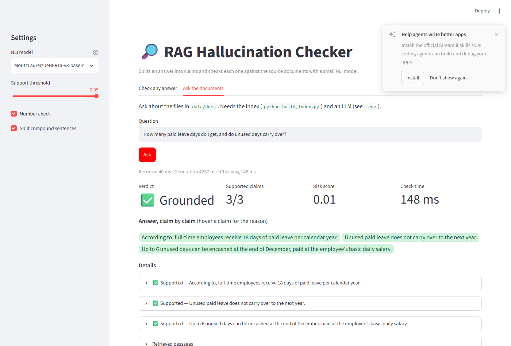

# RAG Hallucination Checker — Demo Walkthrough & Visual Guide

This document presents a visual walkthrough of the **RAG Hallucination Checker** interactive web application ([Streamlit](http://localhost:8501)), illustrating its dual modes of operation: independent answer verification and real-time end-to-end RAG verification.

---

## 1. Mode 1: Check Any Answer (Stand-alone Claim Verification)

In this mode, users can paste arbitrary source context alongside an AI-generated answer. The system executes without requiring an LLM server, operating solely on the local NLI model and deterministic rule checkers.

### Key Functionalities Demonstrated:
1. **Granular Claim Splitting:**
   - The generated response is parsed into individual atomic claims rather than evaluated holistically.
2. **Color-Coded Verdict Badges:**
   - **`✅ Supported` (Green):** Confirmed by the NLI model against the top-ranked 2-sentence source window.
   - **`❌ Contradicted` (Red):** Direct logical contradiction detected against source policy statements.
   - **`⚠️ Not in sources` (Yellow):** Information unsupported or containing unmatched numerical entities (e.g., unmatched count of days).
3. **Interactive Metric Cards:**
   - Overall response verdict, ratio of supported claims, calibrated continuous risk score, and execution latency.
4. **Diagnostic Evidence Expanders:**
   - Each claim expands to display exact entailment/contradiction probabilities and the closest retrieved evidence snippet.

---

## 2. Mode 2: Ask the Documents (Full End-to-End RAG Pipeline)

In this mode, the application functions as a full RAG system over company policy files (`data/docs`), integrating dense vector retrieval, local LLM generation, and automated claim-by-claim verification.

### Execution Flow:
1. **Dense Retrieval:**
   - User queries are encoded using `sentence-transformers/all-MiniLM-L6-v2` and searched across FAISS vector indexes.
2. **Local Generation:**
   - Context-grounded generation is performed using `llama3.2:3b` hosted locally on Ollama.
3. **Live Verification:**
   - Every generated sentence is verified against retrieved source passages in real time before presentation.
4. **Latency Profiling:**
   - Explicit timing breakdown displays the exact latency for retrieval (~30 ms), generation (~2,000 ms), and checking (~350 ms).

---

## 3. Sidebar Configuration Controls

The sidebar enables real-time tuning and model experimentation:
- **NLI Model Selector:** Seamlessly switch between `cross-encoder/nli-deberta-v3-xsmall`, `MoritzLaurer/DeBERTa-v3-base-mnli-fever-anli`, and `DeBERTa-v3-large`.
- **Support Threshold Slider:** Adjust the entailment probability required to accept a claim as supported.
- **Rule Checkers:** Toggle deterministic number validation and compound sentence segmentation.

