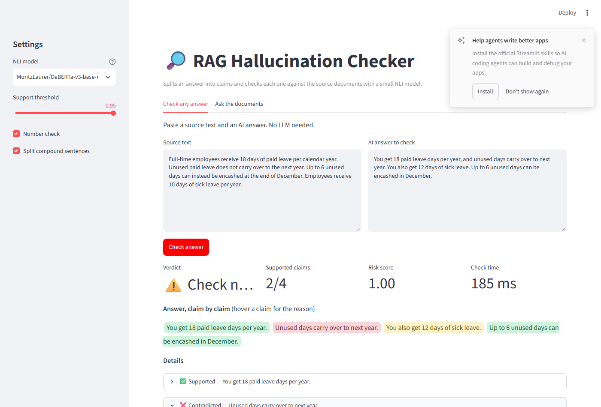

# RAG Hallucination Checker

[](https://www.python.org/)
[](https://pytorch.org/)

A fast, low-cost fact-checker for AI chatbots answering from documents (RAG). It segments every answer into atomic claims, verifies each claim against source passages with a compact Natural Language Inference (NLI) model, and flags unsupported statements in milliseconds instead of the seconds and high token costs required by LLM judges.

```
Question ──► Retriever (FAISS) ──► LLM writes answer ──► Hallucination checker ──► answer with ✅ / ⚠️ / ❌ per claim
                                                          1. split into claims
                                                          2. pick best evidence windows
                                                          3. NLI model: supported? contradicted?
                                                          4. number check
```



> 📸 **Visual Walkthrough:** See [DEMO_WALKTHROUGH.md](DEMO_WALKTHROUGH.md) for full interactive screenshots and end-to-end RAG verification walkthroughs.

**Example.** Source: *"Unused paid leave does not carry over to the next year. Employees receive 10 days of sick leave."*
Answer: *"You get 18 paid leave days, and unused days carry over. You also get 12 days of sick leave."*

| Claim | Verdict |
|---|---|
| You get 18 paid leave days. | ✅ Supported |
| Unused days carry over. | ❌ Contradicted |
| You also get 12 days of sick leave. | ⚠️ Not in sources (number 12 not found) |

---

## 1. Setup

You need **Python 3.10 or newer**.

```bash
# get into the project folder
cd rag-hallucination-checker

# create a virtual environment
python -m venv .venv
# Windows:
.venv\Scripts\activate
# Mac / Linux:
source .venv/bin/activate

pip install -r requirements.txt
copy .env.example .env      # Windows   (Mac/Linux: cp .env.example .env)
```

**Pick an LLM** for writing answers (only needed for the "Ask the documents" part):

- **Ollama (free, offline, default):** install from https://ollama.com, then run `ollama pull llama3.2:3b`. No changes to `.env` needed.
- **Groq (free tier, very fast):** get a key at https://console.groq.com and fill in Option B in `.env`.
- **OpenAI:** fill in Option C in `.env`.

The first run downloads the NLI model (~700 MB) and embedding model (~90 MB) from Hugging Face.

## 2. Run it

```bash
python -m pytest              # 14 quick tests, no downloads needed
python build_index.py         # index the sample documents in data/docs
streamlit run app.py          # open the demo in your browser
python ask.py "How many paid leave days do I get?"   # or use the terminal
```

The demo has two tabs:
- **Check any answer:** paste any source text and any AI answer. No LLM required, so this works right after install.
- **Ask the documents:** full RAG chatbot over `data/docs` with every answer checked live.

To use your own documents, put `.txt`, `.md` or `.pdf` files in a folder and run `python build_index.py --docs your_folder`.

## 3. Evaluate it (the part that makes this a real project)

We use **RAGTruth**, a public dataset of ~18,000 LLM answers where humans marked every hallucinated span.

```bash
git clone https://github.com/ParticleMedia/RAGTruth.git data/RAGTruth

# your checker: 300 test answers, threshold tuned on 300 train answers
python evaluate.py --method checker --limit 300 --tune 300

# try a faster or a stronger NLI model
python evaluate.py --method checker --limit 300 --tune 300 --nli-model cross-encoder/nli-deberta-v3-xsmall
python evaluate.py --method checker --limit 300 --tune 300 --nli-model MoritzLaurer/DeBERTa-v3-large-mnli-fever-anli-ling-wanli

# baseline: LLM-as-judge (uses the LLM in .env). Prices are USD per 1M tokens, e.g. for gpt-4o-mini:
python evaluate.py --method judge --limit 300 --price-in 0.15 --price-out 0.60
```

Each run prints precision, recall, F1, AUROC, per-task scores (QA / Summary / Data2txt), latency (mean, p50, p95), and for the judge, cost per 1,000 answers. Full results are saved in `results/`.

**Fill this table with your own runs. It is the headline of your report and resume:**

| Method | F1 | AUROC | Latency p50 | Cost / 1k answers |
|---|---|---|---|---|
| Number check only (no model) | | | ~1 ms | $0 |
| Checker, DeBERTa-xsmall | 0.586 | 0.733 | 225 ms | $0 |
| Checker, DeBERTa-base | 0.599 | 0.730 | 349 ms | $0 |
| Checker, DeBERTa-large | 0.600 | 0.755 | 905 ms | $0 |
| LLM judge (llama3.2:3b via Ollama) | 0.000 | 0.500 | 1185 ms | $0 |

#### Per-Task Performance Breakdown (Tuned Checker)

| Task | Examples | Base Model F1 (AUROC) | Large Model F1 (AUROC) | xsmall Model F1 (AUROC) |
|---|---|---|---|---|
| **Data2txt** | 84 | 0.761 (0.517) | 0.752 (0.546) | 0.746 (0.572) |
| **QA** | 102 | 0.478 (0.772) | 0.478 (0.787) | 0.417 (0.736) |
| **Summary** | 114 | 0.433 (0.653) | 0.440 (0.687) | 0.440 (0.669) |

*Hardware: NVIDIA GeForce RTX 3050 Laptop GPU (4 GB VRAM), CUDA 12.4, Intel Core i5-12450H.*

A finding already measured during development: **the number check alone** (no ML model at all) flags answers with **~73% precision** at ~26% recall on 600 RAGTruth test answers, where the base hallucination rate is 34%. Cheap rules catch a meaningful share of hallucinations, which is a good point to discuss in your report.

## 4. Error analysis

Analysis of answers from the checker benchmark runs (`results/*_rows.jsonl`) where predictions diverged from ground truth reveals three recurring error patterns:

1. **Structured Data Format Mismatch (False Positives on Data2txt)**:
   In tabular-to-text tasks (e.g., example IDs 8215, 6238, 5850, 6930), the source facts exist as flattened key-value strings (e.g., `hours: Monday: 7:0-22:0`, `attributes: DogsAllowed: False`). The generated answers paraphrase these into fluent, conversational sentences ("The business operates from 7:00 AM to 10:00 PM from Monday to Thursday"). Because the off-the-shelf NLI models were pretrained on natural prose pairs (MNLI/FEVER), they struggle to confirm entailment from raw key-value snippets, predicting neutral/contradiction and assigning near-maximum risk scores (>0.99) to completely factual descriptions.

2. **Context Fragmentation & Multi-Hop Synthesis (False Positives on Summary & QA)**:
   The checker uses sliding 2-sentence windows to keep inference fast and within the NLI model's token limits. When a response sentence synthesizes facts distributed across separate paragraphs in the source document (e.g., ID 4524 combining the distinct sentencing durations of two separate co-defendants), no individual 2-sentence window contains both supporting facts simultaneously. Consequently, the claim receives a low entailment score and is flagged as unsupported.

3. **Threshold Calibration Trade-offs & Fine-Grained Entity Hallucinations (False Negatives)**:
   To combat high false-positive rates on structured data, threshold tuning shifts the decision boundary upward (from 0.50 to ~0.985–0.995). While this improves overall precision, it turns subtle hallucinations with intermediate risk scores (0.80–0.95) into false negatives (e.g., ID 46, ID 12917, ID 14290). Furthermore, when an answer is predominantly truthful but contains an ungrounded entity embedded in a sub-clause (e.g., ID 4347 attributing a real bill to an unmentioned governor), the NLI model is dominated by the strong global topical overlap and fails to isolate the fine-grained hallucinated detail.

## 5. Project structure

```
hallcheck/
  config.py      all settings (read from .env)
  loader.py      read .txt/.md/.pdf files, cut into overlapping chunks
  retriever.py   sentence embeddings + FAISS search
  generator.py   answer writing with any OpenAI-compatible LLM
  claims.py      STEP 1: split answer into claims, skip filler and "I don't know"
  nli.py         STEP 2: NLI model wrapper (entailment / contradiction / neutral)
  numbers.py     STEP 3: catch numbers/dates that are not in the sources
  verifier.py    the checker: evidence ranking + verdict logic
  judge.py       LLM-as-judge baseline
  metrics.py     precision / recall / F1 / AUROC written out by hand
  pipeline.py    retrieve -> generate -> check
app.py           Streamlit demo
ask.py           terminal demo
build_index.py   build the search index
evaluate.py      RAGTruth benchmark
tests/           unit tests with a fake NLI model (run in under a second)
data/docs/       sample company policy documents (fictional company)
```

## 6. Design decisions (be ready to explain these in interviews)

- **Claim-level, not answer-level.** One wrong sentence in a correct answer is the most common failure. Checking claims shows exactly which part is wrong.
- **NLI model instead of an LLM judge.** A DeBERTa NLI model has ~0.2B parameters versus 8B+ for an LLM. It runs locally, costs nothing per call, and returns probabilities you can threshold.
- **Evidence windows + keyword ranking.** NLI models read ~512 tokens. Instead of feeding whole documents, we slide a 2-sentence window over the passages, rank windows by keyword and number overlap, and score only the top 6 per claim. This is the main speed trick.
- **Separate number check.** NLI models often say "February 7, 2022" is entailed by "February 7, 1945". A simple rule fixes that.
- **Skipping abstentions.** "The documents don't mention this" is the correct behaviour, not a hallucination.
- **Threshold tuned on train, reported on test.** Never tune on the test set.

## 7. Known limitations (good material for your "future work" section)

- Claims that combine facts from two far-apart sentences may be marked unsupported.
- Correct arithmetic ("18 + 10 = 28 days in total") is flagged by the number check because 28 is not in the source.
- Rule-based claim splitting can miss pronouns ("It costs Rs. 500"). `claims.llm_extract_claims` is a more accurate, slower alternative.
- English only. Hindi/Telugu would need a multilingual NLI model such as `MoritzLaurer/mDeBERTa-v3-base-xnli-multilingual-nli-2mil7`.

## 8. Ideas to go further

1. Fine-tune the NLI model on RAGTruth's training split and compare to the off-the-shelf model.
2. Report span-level scores (which exact words are hallucinated), not just answer-level.
3. Detect retrieval failures: when no chunk is relevant, the answer was doomed before the LLM wrote it.
4. Auto-fix: regenerate only the unsupported sentences.
5. Wrap the checker in a FastAPI endpoint so any chatbot can call it.
